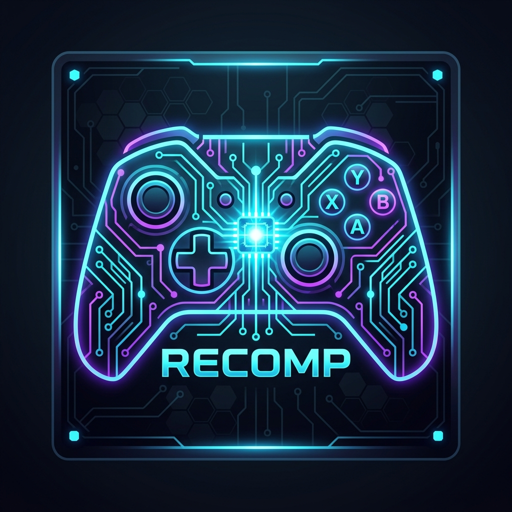
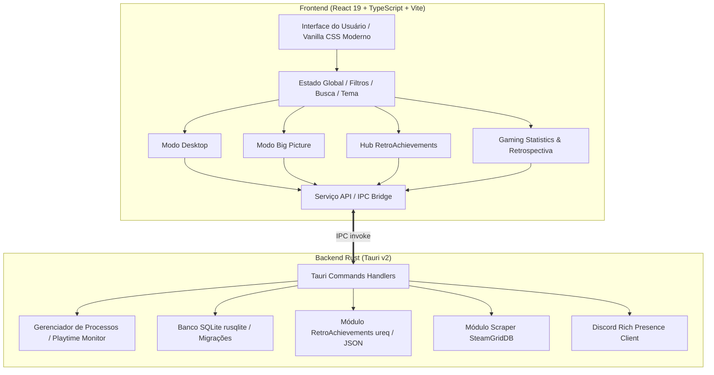

# 🎮 GAMINGZONE LAUNCHER

<div align="center">



**O lançador definitivo de jogos retrô, portas recompiladas e emuladores para PC.**

[](https://tauri.app/)
[](https://react.dev/)
[](https://www.typescriptlang.org/)
[](https://www.rust-lang.org/)
[](https://www.sqlite.org/)
[](https://retroachievements.org/)

</div>

---

## 📖 Visão Geral

O **Gamingzone Launcher** (anteriormente Recomp Launcher) é uma aplicação desktop de alta performance desenvolvida em **Tauri v2**, **Rust** e **React 19**, projetada para unificar e transformar sua experiência ao jogar títulos clássicos no computador.

Criado especialmente para os projetos modernos de **recompilação estática de código** (como *Zelda 64 Recompiled*, *Ship of Harkinian*, *Render96 Mario 64*, *Jak and Daxter OpenGOAL*), emuladores dedicados (PCSX2, Dolphin, DuckStation, RetroArch, RPCS3, Ryujinx) e jogos nativos de PC, o Gamingzone Launcher oferece uma interface visualmente impressionante, rica em detalhes, com suporte completo a controles no **Modo Big Picture**, integração nativa com o **RetroAchievements**, central de **Estatísticas & Retrospectiva Anual** e gerenciamento de saves.

---

## ✨ Principais Funcionalidades

### 🎮 1. Gerenciamento Completo de Biblioteca
- **Portas Recompiladas & Emuladores:** Organize portas nativas de PC e jogos emulados lado a lado, com categorias dedicadas (PS2, PS1, N64, GameCube, SNES, GBA, Mega Drive, PSP, etc.).
- **Importação em Lote:** Escaneie diretórios e coleções de ROMs automaticamente com o assistente inteligente de importação em lote.
- **Rastreamento de Tempo de Jogo:** Contabilização precisa do tempo jogado por sessão e histórico acumulado total.
- **Favoritos e Status de Jogo:** Marque jogos favoritos e defina status (*Jogando*, *Zerado*, *Dropado*, *Pausado*, *Na Fila*).

### 📺 2. Modo Big Picture (Experiência 10-Foot / TV & Controles)
- **Navegação com Controle (Gamepad):** Suporte nativo a controles de Xbox, PlayStation e Nintendo Switch, além de navegação total via teclado/D-Pad.
- **Carrossel Imersivo:** Navegação fluida com banners widescreen, efeitos sonoros visuais e lançamento rápido de jogos.
- **Acesso Irrestrito:** Acesse a central de estatísticas, lista de conquistas do RetroAchievements, filtros de plataformas e configurações sem precisar voltar ao modo desktop.

### 🏆 3. Hub Completo do RetroAchievements (Ao Vivo)
- **Perfil Sincronizado:** Exibição do seu Rank Mundial real (`API_GetUserSummary.php`), Total de Jogadores Ranqueados, Pontuação Hardcore, Pontos de Raridade (*True Points*), Lema (*Motto*) e Foto de Perfil oficial.
- **Jogos da Conta:** Lista consolidada de todos os jogos com conquistas registradas na sua conta RetroAchievements (via `GetUserCompletionProgress` e `GetUserRecentlyPlayedGames`), com barra de progresso individual e selo dourado para jogos 100% *Mastered*.
- **Rastreador de Conquistas por Jogo:** Visualize cada conquista com seu badge original em alta definição (colorido para desbloqueadas e escurecido para bloqueadas), título, descrição, pontos e data exata de desbloqueio em modo Hardcore.
- **Busca & Associação de IDs:** Detecção automática do ID do jogo no RetroAchievements com opção de busca por nome ou inserção manual do ID.

### 📊 4. Gaming Statistics & Retrospectiva Gamingzone
- **Central de Estatísticas:** Painel detalhado com total de horas jogadas, número de sessões, plataforma mais jogada, gênero predominante e distribuição mensal de jogatina.
- **Retrospectiva Gamingzone (Year in Review):** Uma experiência temática inspirada no *Steam Replay* / *Spotify Wrapped*, permitindo selecionar qualquer ano ou histórico completo para visualizar recordes, jogo do ano, maior maratona em um único dia e medalhas de conquista.

### 🎨 5. Sistema de Temas e Tipografia Dinâmica
- **Paletas Curadas:** Alterne instantaneamente entre diversos temas com estética neon e moderna:
  - *Cyberpunk Neon* (Ciano e Magenta vibrantes)
  - *Cyber Void* (Monocromático escuro minimalista)
  - *Retrowave Sunset* (Roxo e Laranja anos 80)
  - *Emerald Matrix* (Verde cibernético profundo)
  - *Midnight Navy* (Azul escuro refinado)
- **Troca de Fontes em Tempo Real:** Escolha entre famílias tipográficas modernas (Outfit, Inter, Chakra Petch, Orbitron, JetBrains Mono), adaptando toda a interface ao seu gosto.

### 🖼️ 6. Scraper e Editor Manual de Capas & Banners
- **Scraper SteamGridDB:** Pesquise pôsteres verticais e banners horizontais de alta definição diretamente da comunidade com pré-visualização instantânea.
- **Editor Manual:** Adicione URLs personalizadas ou faça upload de arquivos locais de capa e banner para qualquer jogo da sua biblioteca.

### 💾 7. Gerenciador de Backups de Saves
- Crie instantâneos (*snapshots*) e backups dos arquivos de save do jogo com um único clique antes de testar modificações ou atualizar versões recompiladas.
- Restaure ou exclua backups anteriores diretamente da tela de detalhes do jogo.

### 💬 8. Discord Rich Presence (RPC)
- Exibição de status dinâmico no perfil do Discord: mostra o jogo em execução, plataforma e tempo decorrido de partida.

---

## 🏗️ Arquitetura do Projeto



---

## 📁 Estrutura de Pastas

```text
recomp-launcher/
├── public/                     # Recursos estáticos e ícones
│   ├── app-icon.png            # Ícone oficial do Gamingzone Launcher
│   └── tauri.svg
├── src/                        # Código-fonte do Frontend (React + TS)
│   ├── components/             # Componentes modulares da interface
│   │   ├── AddGameModal.tsx            # Modal de adição manual de jogos
│   │   ├── AutoScraperModal.tsx        # Modal de busca de capas via SteamGridDB
│   │   ├── BatchImportModal.tsx        # Modal de importação em lote de ROMs
│   │   ├── BigPictureMode.tsx          # Interface imersiva Big Picture
│   │   ├── GameCard.tsx                # Card animado do jogo na grade principal
│   │   ├── GameDetailsModal.tsx        # Detalhes, estatísticas, saves e capas
│   │   ├── ReplayView.tsx              # Gaming Statistics & Retrospectiva
│   │   ├── RetroAchievementsModal.tsx  # Widget rápido de conquistas
│   │   ├── RetroAchievementsView.tsx   # Hub completo de conquistas e jogos RA
│   │   ├── SettingsModal.tsx           # Configurações, emuladores e temas
│   │   └── Sidebar.tsx                 # Barra lateral de navegação e filtros
│   ├── services/
│   │   └── api.ts              # Comunicação via invoke com Tauri e fallbacks web
│   ├── types/
│   │   └── index.ts            # Tipagens TypeScript (Game, Session, RA, Theme)
│   ├── App.tsx                 # Componente raiz e orquestrador de telas
│   ├── index.css               # Design system com tokens HSL, animações e temas
│   └── main.tsx                # Ponto de entrada React
├── src-tauri/                  # Código-fonte do Backend (Rust + Tauri v2)
│   ├── src/
│   │   ├── commands.rs         # Definição dos comandos IPC Tauri
│   │   ├── db.rs               # Camada de banco de dados SQLite
│   │   ├── discord.rs          # Integração Discord Rich Presence
│   │   ├── lib.rs              # Registro de plugins e comandos da biblioteca
│   │   ├── main.rs             # Executável Tauri
│   │   ├── process_manager.rs  # Execução e monitoramento de processos
│   │   ├── retroachievements.rs# Integração completa da API RetroAchievements
│   │   └── scraper.rs          # Web scraping de capas e banners
│   ├── Cargo.toml              # Dependências e perfil de compilação em Rust
│   └── tauri.conf.json         # Configuração de janelas e empacotamento Tauri
├── package.json                # Dependências Node.js e scripts
├── tsconfig.json               # Configuração TypeScript
└── vite.config.ts              # Configuração Vite
```

---

## 🚀 Instalação e Execução

### Pré-requisitos

Certifique-se de ter instalado no seu sistema:
1. **[Node.js](https://nodejs.org/)** (versão 18 ou superior) e gerenciador `npm`.
2. **[Rust](https://www.rust-lang.org/tools/install)** (versão estável mais recente).
3. **Ferramentas de Compilação C++** (No Windows, instale o *Visual Studio C++ Build Tools*).

### Passo a Passo

1. **Clone o repositório:**
   ```bash
   git clone https://github.com/seu-usuario/recomp-launcher.git
   cd recomp-launcher
   ```

2. **Instale as dependências do frontend:**
   ```bash
   npm install
   ```

3. **Inicie em modo de desenvolvimento com Tauri:**
   ```bash
   npm run tauri dev
   ```

   > Caso queira rodar apenas a interface web no navegador para testes rápidos de design:
   > ```bash
   > npm run dev
   > ```

4. **Compilar o instalador de produção (.exe / MSI):**
   ```bash
   npm run tauri build
   ```
   O instalador e os binários finais serão gerados no diretório `src-tauri/target/release/bundle/`.

---

## ⚙️ Configuração do RetroAchievements

Para ativar a sincronização em tempo real de suas conquistas e ranking:

1. Acesse sua conta em [retroachievements.org](https://retroachievements.org/).
2. Vá em **Settings** > **Keys** e copie sua **Web API Key**.
3. Abra o **Gamingzone Launcher**, clique no ícone de engrenagem ⚙️ (**Configurações**).
4. Na aba **RetroAchievements**, informe seu **Nome de Usuário** e cole sua **Web API Key**.
5. Clique em **Testar Conexão / Buscar Perfil**.
6. Pronto! Acesse a aba **Conquistas** na barra lateral para explorar seus jogos da conta, badges em alta resolução e posição no ranking mundial.

---

## 🎮 Controles no Modo Big Picture

| Tecla / Botão | Ação |
| :--- | :--- |
| **Setas / D-Pad** | Navegar entre os jogos no carrossel e menus |
| **Enter / Botão A (Xbox) / ╳ (PS)** | Iniciar jogo selecionado / Confirmar opção |
| **Espaço / Botão X (Xbox) / ▢ (PS)** | Abrir detalhes do jogo selecionado |
| **F / Botão Y (Xbox) / △ (PS)** | Alternar favorito |
| **Tab / RB / R1** | Alternar entre seções (Biblioteca, Conquistas, Estatísticas) |
| **F11** | Alternar tela cheia |
| **Esc / Botão B (Xbox) / ◯ (PS)** | Sair do Modo Big Picture / Fechar modal |

---

## 🛠️ Tecnologias e Bibliotecas

- **Core & Runtime:** [Tauri v2](https://tauri.app/), [Rust 2021](https://www.rust-lang.org/)
- **Frontend:** [React 19](https://react.dev/), [TypeScript](https://www.typescriptlang.org/), [Vite](https://vitejs.dev/)
- **Estilização:** Vanilla CSS Moderno com suporte a temas dinâmicos via variáveis CSS (Custom Properties), Glassmorphism e Google Fonts.
- **Banco de Dados:** [SQLite](https://sqlite.org/) embarcado via [rusqlite](https://crates.io/crates/rusqlite).
- **Requisições de Rede (Rust):** [ureq](https://crates.io/crates/ureq) com suporte a JSON.
- **Rich Presence:** [discord-rich-presence](https://crates.io/crates/discord-rich-presence).
- **Diálogos Nativos do Sistema:** [rfd](https://crates.io/crates/rfd).
- **Ícones:** [lucide-react](https://lucide.dev/).

---

## 📄 Licença

Distribuído sob a licença **MIT**. Veja `LICENSE` para mais detalhes.

---

<div align="center">
Feito com paixão para a comunidade de preservação e recompilação de jogos clássicos. 🕹️✨
</div>
